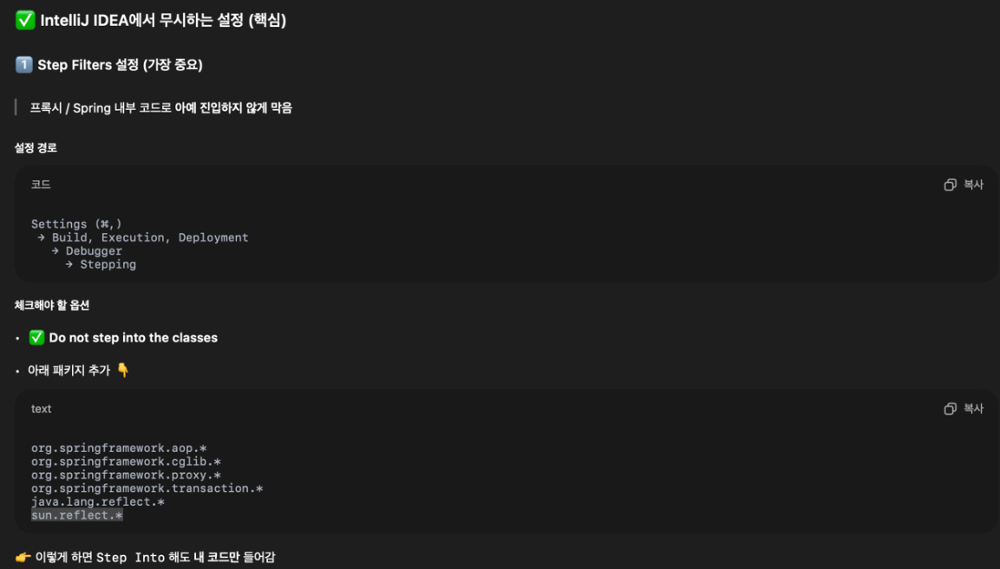
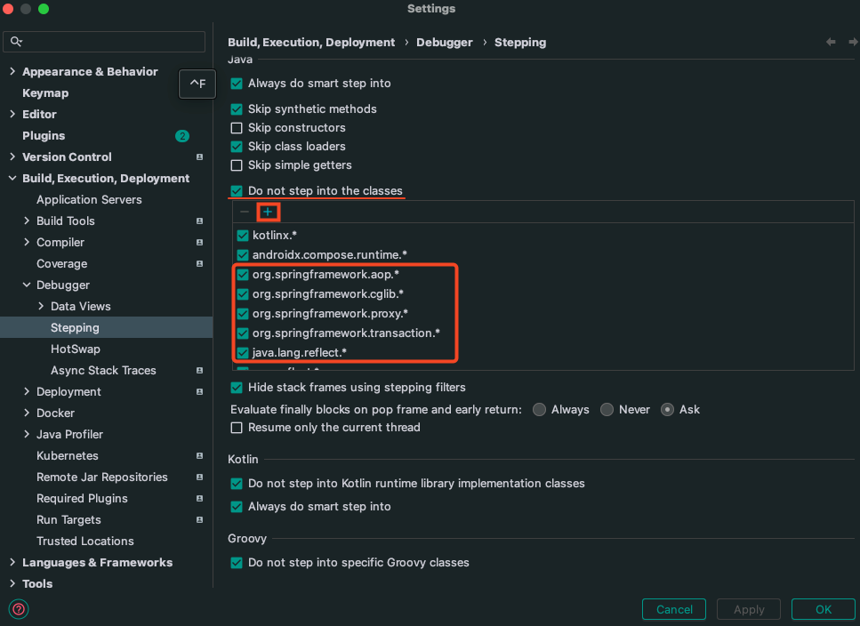

# 인텔리제이 디버거 설정

<br/><br/><br/>


## Proxy등 이상한 클래스에 들어가지 않도록 설정 방법

---

  

  

- Settings > Build, Execution, Deployment > Debugger > Stepping
  - Do not step into the classes
  - add Options String
  - ```
    org.springframework.aop.*
    org.springframework.cglib.*
    org.springframework.proxy.*
    org.springframework.transaction.*
    java.lang.reflect.*
    sun.reflect.*
    ```
    

